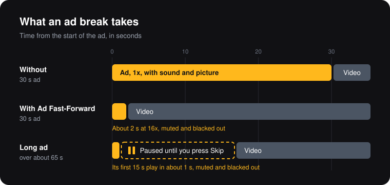

  

<h1 align="center">Ad Fast-Forward for YouTube</h1>

  YouTube 동영상 광고를 음소거하고, 화면을 검게 가리고, 16배속으로 재생하는 Chrome 확장 프로그램입니다. 
  긴 광고는 한 번 멈추므로 직접 건너뛰기(Skip)를 누르면 됩니다.

  

  
  
  
  
  
  

<a href="README.md">English</a> · 한국어

  

> 이 문서는 [영어 README](README.md)의 번역입니다. 내용이 다르면 영어 문서가 기준입니다.

## 특징

- **YouTube에만 접근합니다.** 권한을 요청하지 않고 `www.youtube.com` 페이지에서만 동작합니다. Chrome에는 "www.youtube.com의 데이터를 읽고 변경"으로 표시됩니다. 네트워크 요청, 저장, 분석 도구가 없습니다.
- **직접 읽어 볼 수 있을 만큼 작습니다.** 순수 JavaScript와 CSS로 400줄이 안 되고, 빌드 단계와 의존성이 없습니다. 읽는 코드가 곧 Chrome이 실행하는 코드입니다.
- **첫 프레임부터 조용합니다.** 광고 영상은 재생되기 전에 음소거되고, 탭도 예비로 음소거됩니다. 광고 두 개 사이의 틈에서도 광고 소리가 새지 않습니다.
- **조작은 사용자가 합니다.** 건너뛰기를 대신 누르지 않습니다. 긴 광고는 사용자가 누를 때까지 멈춰서 기다립니다.
- **뒷정리를 합니다.** 자신이 건 음소거만 풉니다. 사용자가 건 음소거와 다른 확장 프로그램이 건 음소거는 그대로 둡니다.
- **변경마다 테스트합니다.** 가짜 YouTube 페이지를 상대로 한 e2e 테스트가 CI에서 실행되므로, 테스트가 YouTube에 접속하지 않습니다.

## 설치

**[Chrome 웹스토어에서 Ad Fast-Forward 설치하기](https://chromewebstore.google.com/detail/lppcpcgcnibijccfpccdbcpilhmoajjl)**. 설치한 뒤에는 열려 있는 YouTube 탭을 새로고침하세요. 확장 프로그램 메뉴(퍼즐 아이콘)에서 고정해 두면 광고 중에 툴바 아이콘을 바로 누를 수 있습니다.

Chrome 123 이상이 필요합니다. 설치하기 전에 [YouTube 정책 변경](#youtube-정책-변경)을 읽어 주세요.

확장이 업데이트되거나, 확장을 끄거나 다시 로드한 뒤에는 열려 있는 YouTube 탭도 새로고침하세요. 그러지 않으면 CSS만 남아서 광고가 검은 화면에 1배속으로, 소리와 함께 재생됩니다.

### 릴리스에서 설치

스토어를 거치지 않고 설치하는 방법입니다.

1. [최신 릴리스](https://github.com/freezinghands/youtube-ad-fast-forward/releases/latest)에서 ZIP을 내려받아 압축을 풉니다. 이 저장소를 클론해서 `extension/` 폴더를 써도 됩니다.
2. `chrome://extensions`를 열고 **개발자 모드**를 켭니다.
3. **압축해제된 확장 프로그램 로드**를 누르고 압축을 푼 폴더(또는 `extension/`)를 고릅니다.
4. 확장 프로그램 메뉴(퍼즐 아이콘)에서 Ad Fast-Forward를 고정해 두면 광고 중에 툴바 아이콘을 바로 누를 수 있습니다.

Chrome은 이렇게 설치한 확장을 자동으로 업데이트하지 않습니다. 새 릴리스가 나오면 수동으로 업데이트해야 합니다.

## 동작 방식

- 플레이어(`#movie_player`)에 `ad-showing` 클래스가 있으면 광고 중으로 봅니다.
- 광고 중에는 Chrome이 허용하는 최고 속도인 16배속으로 재생합니다.
- 광고 중에는 영상을 숨기므로 플레이어가 검게 보입니다. 건너뛰기 버튼 같은 광고 UI는 보입니다. 긴 광고가 멈춰 있는 동안에도 검게 유지됩니다. CSS가 `ad-showing` 클래스에 걸려 있으므로 광고가 끝나면 저절로 풀립니다.
- 광고를 감지하는 즉시 광고 영상을 음소거합니다(`m` 키와 같은 효과지만 토글이 아닙니다). 광고를 불러오면서 YouTube가 음소거를 풀면 다시 음소거합니다. 예비로 탭도 음소거합니다.
- 긴 광고는 15초가 재생된 시점에 50초 이상 남아 있으면 한 번 멈춥니다. 15초가 지나야 건너뛰기가 열리는 광고가 있어서, 그보다 일찍 멈추지는 않습니다. 그래서 약 65초보다 긴 광고만 멈추고, 흔한 20초 광고는 16배속으로 1초 남짓 만에 끝납니다. 건너뛰기는 직접 누릅니다(YouTube는 스크립트의 클릭을 무시합니다). 누를 때까지 광고는 멈춘 채 기다립니다. 대신 재생을 누르면 그 광고는 다시 멈추지 않습니다. 이 규칙은 광고 영상의 길이만 보며, 건너뛰기 버튼의 모양이나 클래스는 보지 않습니다.
- 광고가 끝나면 속도는 바로 돌아오고 소리는 0.8초 뒤에 돌아옵니다. 그래서 연달아 나오는 광고 사이의 틈도 조용합니다.
- 광고 중에 플레이어를 누르면 건너뛰기일 수 있으므로 속도를 바로 되돌립니다. 1.5초 안에 광고가 끝나고 새 영상이 시작되면 0.8초를 기다리지 않고 소리를 돌려줍니다. 건너뛰기가 아니었다면 1.5초 뒤 다시 16배속이 됩니다. 볼륨 조작은 여기에 해당하지 않습니다.

## 안전장치

- 자신이 건 음소거만 풉니다. 광고 전에 음소거된 영상, 사용자나 다른 확장 프로그램이 음소거한 탭은 그대로 음소거 상태로 남습니다.
- 광고 중에 영상 소리를 켜면(음소거 버튼, `m`, 위/아래 화살표 키) 광고가 끝날 때까지 다시 음소거하지 않습니다. 다만 탭 음소거는 남아 있으니, 광고 소리를 바로 들으려면 툴바 아이콘을 누르세요.
- 탭 음소거는 페이지가 계속 갱신하는 동안에만 유지됩니다. 갱신이 6초 동안 끊기면 저절로 풀립니다. 광고 중에 페이지를 떠나면 바로 풀립니다.
- 광고 중에 툴바 아이콘을 누르면 광고와 탭의 음소거가 바로 풀리고, 연달아 나오는 광고가 모두 끝날 때까지 풀린 채로 유지됩니다. 광고가 아닐 때 누르면 다음 광고에는 아무 영향이 없습니다.

## 자주 묻는 질문

**건너뛰기를 대신 눌러 줄 수 있나요?**
아니요. YouTube는 스크립트의 클릭을 무시하고, 이 확장은 건너뛰기를 일부러 사용자에게 맡깁니다. 대부분의 광고는 16배속으로 1~2초 안에 끝나고, 약 65초보다 긴 광고만 사용자를 기다립니다.

**속도를 바꿀 수 있나요?**
아니요. 16배속은 Chrome이 허용하는 최고 속도이고, 더 낮추면 광고가 길어질 뿐입니다.

**광고를 차단하나요?**
아니요. 광고는 그대로 불러와서 재생되며, 음소거되고 가려진 채 16배속으로 재생될 뿐입니다. 이렇게 재생된 광고를 YouTube가 어떻게 집계하는지는 YouTube가 정합니다.

**YouTube Music, m.youtube.com, Shorts, 다른 사이트에 임베드된 영상에서도 동작하나요?**
`www.youtube.com` 페이지에서만, 그것도 메인 동영상 플레이어(`#movie_player`)의 광고만 처리합니다. Shorts는 다른 플레이어를 쓰므로 Shorts 광고는 처리하지 않으며, 다른 YouTube 도메인, 다른 사이트, 임베드 플레이어도 대상이 아닙니다.

**Edge, Brave, Opera, 웨일에서도 동작하나요?**
Chrome 확장을 설치할 수 있는 Chromium 브라우저라면 동작할 것으로 보지만, 테스트는 Chrome에서만 합니다. Firefox는 아직 지원하지 않습니다. [`browser-port` 이슈](https://github.com/freezinghands/youtube-ad-fast-forward/labels/browser-port)를 참고하세요. 다른 브라우저에서 써 본 결과도 그곳에 남겨 주세요.

**데이터를 수집하나요?**
아니요. 네트워크 요청을 하지 않고, 아무것도 저장하지 않으며, 어디에도 보내지 않습니다.

**YouTube에서 경고가 떴거나, 광고가 더 이상 빨라지지 않아요.**
[YouTube 정책 변경](#youtube-정책-변경)을 참고하세요. 확장이 동작하지 않게 됐다면 [버그 리포트](https://github.com/freezinghands/youtube-ad-fast-forward/issues/new?template=bug_report.yml)를 열어 주세요.

## YouTube 정책 변경

이 확장은 지금의 YouTube 동작 방식에 기대고 있습니다. YouTube는 플레이어, 광고 규칙, 단속 방식을 언제든 예고 없이 바꿀 수 있으므로, 여기 적힌 동작은 언제든 멈추거나 문제를 일으킬 수 있습니다. 이 확장은 YouTube나 Google과 관계가 없으며, 사용에 따른 책임은 사용자에게 있습니다.

**서비스 약관.** YouTube는 광고 차단이 [서비스 약관](https://www.youtube.com/t/terms) 위반이라고 밝히고 있고, 약관은 서비스를 우회하거나 방해하는 행위를 금지합니다. 이 확장은 아무것도 차단하지 않습니다. 광고는 그대로 불러와서 재생되며, 음소거되고 가려진 채 16배속으로 재생될 뿐입니다. 그래도 YouTube는 이를 방해 행위로 볼 수 있습니다.

**감지.** YouTube 플레이어는 이미 약 2.5배속보다 빠르게 재생된 광고를 기록합니다(플레이어 빌드 `7460dd14`, 2026년 9월에 확인). 플레이어는 서버 응답이 지시할 때만 단속을 표시하므로, 확장의 새 버전 없이도 단속은 언제든 시작될 수 있습니다.

| YouTube가… | 나타날 수 있는 일 |
|---|---|
| 빠르거나, 음소거되거나, 가려진 광고를 단속하면 | YouTube가 광고 차단기에 썼던 것처럼 경고창, 지연, 재생 차단이 나타날 수 있습니다. 계정에 미치는 영향은 관찰할 수 없습니다. |
| 광고를 실제 길이만큼 보게 하면 | 16배속으로 아끼는 시간이 거의 없어집니다. 광고가 원래 길이만큼 걸리거나, 광고가 끝난 뒤 영상이 기다립니다. |
| 건너뛰기가 열리는 시점을 바꾸거나 숨기면 | 15초 시점의 멈춤이 건너뛰기가 열리기 전에 오거나, 건너뛰기가 아예 나타나지 않습니다. 재생을 누르면 광고가 끝까지 재생됩니다. |
| 광고를 별도 소스가 아닌 영상 스트림 안에 넣으면 | 16배속과 긴 광고 멈춤이 동작하지 않거나 잘못된 길이를 기준으로 동작할 수 있습니다. |
| 플레이어 마크업(`#movie_player`, `ad-showing`, `html5-main-video`)을 바꾸면 | 광고가 일부만 처리되거나 전혀 처리되지 않습니다. 예를 들어 검은 화면에 1배속으로, 또는 소리와 화면이 그대로인 채 1배속으로 재생됩니다. |
| 광고가 아닐 때도 `ad-showing`을 남겨 두면 | 본 영상이 광고로 취급되어 검게, 음소거된 채, 16배속으로 재생됩니다. |

이 확장은 경고를 감지하거나 스스로 대응하지 않습니다. 수정 사항은 새 버전으로만 전달되며, 스토어에서 설치했다면 Chrome이 새 버전을 설치해 줍니다. 이런 일이 생기면 `chrome://extensions`에서 확장을 끄고 YouTube 탭을 새로고침하세요.

## 번역

확장의 이름, 설명, 툴바 툴팁은 [`extension/_locales/`](extension/_locales)에서 번역하며, 지금은 영어와 한국어가 있습니다. 언어를 추가하려면 [CONTRIBUTING.md의 Translations](CONTRIBUTING.md#translations)를 보거나 [번역 이슈](https://github.com/freezinghands/youtube-ad-fast-forward/issues/new?template=translation.yml)를 열어 주세요.

## 로드맵

- [x] [Chrome 웹스토어 등록](https://chromewebstore.google.com/detail/lppcpcgcnibijccfpccdbcpilhmoajjl)
- [ ] Microsoft Edge Add-ons, 네이버 웨일 스토어 등록
- [ ] Firefox 지원 ([`browser-port` 이슈](https://github.com/freezinghands/youtube-ad-fast-forward/labels/browser-port), 도움 요청)
- [ ] 번역 추가 ([`translation` 이슈](https://github.com/freezinghands/youtube-ad-fast-forward/labels/translation), 처음 기여하기 좋은 이슈)

기능 범위는 고정입니다: 음소거, 화면 가리기, 16배속, 긴 광고 한 번 멈춤. [CONTRIBUTING.md의 Ground rules](CONTRIBUTING.md#ground-rules)를 참고하세요.

## 구성

| 경로 | 역할 |
|---|---|
| `extension/manifest.json` | 확장 정의 |
| `extension/content.js` | 광고 감지, 16배속과 복원, 영상 음소거, 긴 광고 멈춤 |
| `extension/content.css` | 광고 영상을 숨겨 플레이어를 검게 보이게 함 |
| `extension/sw.js` | 예비 탭 음소거와 해제 |
| `extension/_locales/` | 번역된 이름, 설명, 툴바 툴팁 |
| `extension/icons/` | 아이콘 (`assets/icon.svg`에서 내보냄) |
| `assets/` | 아이콘 원본과 이 README의 도식 |
| `test/` | 가짜 YouTube 페이지를 상대로 한 e2e 테스트 |

## 기여

버그 리포트, 번역, 풀 리퀘스트를 환영합니다. 처음이라면 [good first issue](https://github.com/freezinghands/youtube-ad-fast-forward/labels/good%20first%20issue)부터 보세요. 기본 규칙과 테스트 실행 방법은 [CONTRIBUTING.md](CONTRIBUTING.md)에 있고(영어), 질문은 [Discussions](https://github.com/freezinghands/youtube-ad-fast-forward/discussions)에 남겨 주세요. 참여하는 모든 사람은 [행동 강령](CODE_OF_CONDUCT.md)을 따릅니다. 보안 문제는 [SECURITY.md](SECURITY.md)에 적힌 방법으로 알려 주세요.

Ad Fast-Forward가 시간을 아껴 줬다면, 별(Star)을 눌러 주세요. 다른 사람이 찾는 데 도움이 됩니다.

## 라이선스

[Apache License 2.0](LICENSE). Copyright 2026 Lee Jaeyun. [NOTICE](NOTICE)를 참고하세요. 이 확장이나 수정한 버전을 재배포할 때는 LICENSE와 NOTICE 파일을 함께 포함해야 합니다.

YouTube와 Chrome은 Google LLC의 상표입니다. 이 프로젝트는 YouTube나 Google과 제휴, 보증, 후원 관계가 없습니다.
