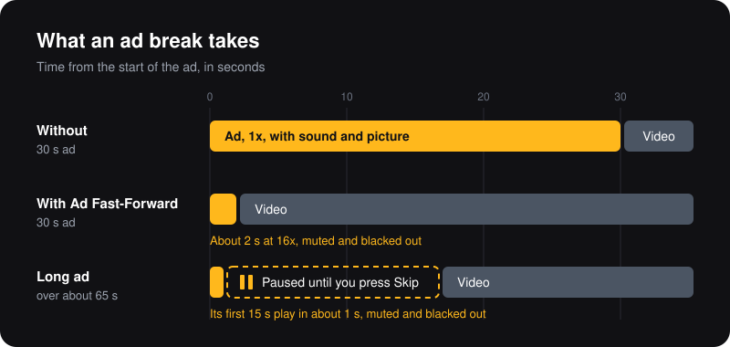

  

<h1 align="center">Ad Fast-Forward for YouTube</h1>

  A Chrome extension that mutes YouTube video ads, blacks them out and plays them at 16x. 
  Long ads pause once so you can press Skip yourself.

  

  
  
  
  
  
  

English · <a href="README.ko.md">한국어</a>

  

## Highlights

- **Access to YouTube only.** It asks for no permissions and runs only on `www.youtube.com` pages, which Chrome shows as "Read and change your data on www.youtube.com". It makes no network requests, stores nothing and has no analytics.
- **Small enough to read.** Under 400 lines of plain JavaScript and CSS, with no build step and no dependencies: the code you read is the code Chrome runs.
- **Silent from the first frame.** The ad video is muted before it plays and the tab is muted as a backup, so no ad audio slips through, even in the gap between two ads.
- **You stay in control.** It never clicks Skip for you. A long ad waits, paused, until you press it.
- **It cleans up after itself.** It undoes only the mutes it made: your own mute and other extensions' mutes stay.
- **Tested on every change.** End-to-end tests run in CI against a fake YouTube page, so the tests never contact YouTube.

## Install

**[Install Ad Fast-Forward from the Chrome Web Store](https://chromewebstore.google.com/detail/lppcpcgcnibijccfpccdbcpilhmoajjl)**. Then reload your open YouTube tabs, and pin it from the Extensions menu (the puzzle icon) so its toolbar icon is at hand during an ad.

It needs Chrome 123 or later. Before you install it, read [YouTube policy changes](#youtube-policy-changes).

After the extension updates, or after you turn it off or reload it, reload your open YouTube tabs too. Otherwise their ads play black, at 1x and with sound, because only the CSS is left.

### Install from a release

To install it without the store:

1. Download the ZIP from the [latest release](https://github.com/freezinghands/youtube-ad-fast-forward/releases/latest) and unzip it. You can also clone this repository and use its `extension/` folder.
2. Open `chrome://extensions` and turn on **Developer mode**.
3. Click **Load unpacked** and choose the unzipped folder (or `extension/`).
4. Pin Ad Fast-Forward from the Extensions menu (the puzzle icon) so its toolbar icon is at hand during an ad.

Chrome does not automatically update an extension installed this way. When a new release comes out, you have to update it manually.

## How it works

- An ad is showing when the player (`#movie_player`) has the `ad-showing` class.
- During an ad the video plays at 16x, the highest rate Chrome allows.
- During an ad the video is hidden, so the player shows black. Ad UI such as the Skip button stays visible. The player stays black while a long ad is paused. The CSS depends on the `ad-showing` class, so it lifts by itself when the ad ends.
- The ad video is muted as soon as the ad is detected (the same effect as the `m` key, but not a toggle). If YouTube unmutes it while loading an ad, it is muted again. The tab is muted too, as a backup.
- A long ad pauses once, after 15 s of it have played, if at least 50 s remain. Some ads open Skip only after 15 s, so it never pauses earlier. As a result only ads longer than about 65 s pause; a typical 20 s ad ends in just over a second at 16x. You press Skip yourself (YouTube ignores clicks made by scripts), and the ad waits, paused, until you do. If you press Play instead, that ad does not pause again. The rule uses only the length of the ad video, never the look or class of the Skip button.
- When the ad ends, the rate goes back at once and sound comes back 0.8 s later, so the gap between two ads in a row stays silent.
- A press in the player during an ad may be Skip, so the rate goes back at once. If within 1.5 s the ad ends and a new video starts, sound comes back without the 0.8 s wait. If the press was not Skip, the ad returns to 16x after 1.5 s. Presses on the volume controls do not count.

## Safeguards

- The extension undoes only the mutes it made. A video muted before the ad, and a tab muted by you or by another extension, stay muted.
- If you unmute the video during an ad (mute button, `m`, or the Up/Down arrow keys), it is not muted again until the ads end. The tab mute stays, though: to hear the ad right away, click the toolbar icon.
- The tab mute lasts only while the page keeps renewing it. If renewals stop for 6 s, it lifts by itself. Leaving the page during an ad lifts it at once.
- Clicking the toolbar icon during an ad unmutes the ad and the tab at once and keeps them unmuted until the ads in a row have all ended. A click outside ads changes nothing for the next ad.

## FAQ

**Can it click Skip for me?**
No. YouTube ignores clicks made by scripts, and the extension leaves Skip to you on purpose. Most ads end at 16x in a second or two anyway; only ads longer than about 65 s wait for you.

**Can I choose a different speed?**
No. 16x is the highest rate Chrome allows, and a lower rate only makes ads take longer.

**Does it block ads?**
No. The ad still loads and plays, muted, hidden and at 16x. Whether YouTube counts an ad played this way is up to YouTube.

**Does it work on YouTube Music, m.youtube.com, Shorts or videos embedded on other sites?**
It runs only on `www.youtube.com` pages and handles ads only in the main video player there (`#movie_player`). Shorts use a different player, so their ads are not handled, and other YouTube domains, other sites and embedded players are not covered either.

**Does it work in Edge, Brave, Opera or Whale?**
It should work in Chromium browsers that install Chrome extensions, but only Chrome is tested. Firefox is not supported yet; see the [`browser-port` issues](https://github.com/freezinghands/youtube-ad-fast-forward/labels/browser-port). Reports from other browsers are welcome there.

**Does it collect any data?**
No. It makes no network requests, stores nothing and sends nothing anywhere.

**YouTube showed me a warning, or ads are no longer sped up.**
See [YouTube policy changes](#youtube-policy-changes). If the extension stopped working, [open a bug report](https://github.com/freezinghands/youtube-ad-fast-forward/issues/new?template=bug_report.yml).

## YouTube policy changes

This extension relies on how YouTube works today. YouTube can change its player, its ad rules and its enforcement at any time and without notice, so any behaviour described here can stop working or start causing problems. The extension is not affiliated with YouTube or Google, and you use it at your own risk.

**Terms of Service.** YouTube says that blocking ads violates its [Terms of Service](https://www.youtube.com/t/terms), and those terms prohibit circumventing or interfering with the service. This extension blocks nothing: the ad still loads and plays, muted, hidden and at 16x. YouTube may still treat that as interference.

**Detection.** YouTube's player already records ads that play faster than about 2.5x (seen in player build `7460dd14`, September 2026). The player shows enforcement only when the server's response tells it to, so enforcement can start at any time, with no new extension version.

| If YouTube… | You may see |
|---|---|
| enforces against fast, muted or hidden ads | A warning dialog, delays or blocked playback, as YouTube has used against ad blockers. Effects on an account cannot be observed. |
| requires ads to take their real length | 16x saves little or no time: the ad takes its full length, or the video waits after it ends. |
| changes when Skip opens, or hides it | The pause at 15 s comes before Skip opens, or Skip never appears. Press Play and the ad runs to its end. |
| puts ads inside the video stream instead of a separate source | 16x and the long-ad pause may stop working or act on the wrong length. |
| changes its player markup (`#movie_player`, `ad-showing`, `html5-main-video`) | Ads are handled only in part or not at all: for example they play at 1x in black, or at 1x with sound and picture. |
| keeps `ad-showing` on outside ads | The video itself is treated as an ad: black, muted and at 16x. |

The extension does not detect warnings or adapt by itself. A fix reaches you only as a new version, which Chrome installs for you if you installed from the store. If any of this happens, turn it off in `chrome://extensions` and reload your YouTube tabs.

## Translations

The extension's name, description and toolbar tooltip are translated in [`extension/_locales/`](extension/_locales), currently into English and Korean. To add a language, see [Translations in CONTRIBUTING.md](CONTRIBUTING.md#translations) or [open a translation issue](https://github.com/freezinghands/youtube-ad-fast-forward/issues/new?template=translation.yml).

## Roadmap

- [x] [Chrome Web Store listing](https://chromewebstore.google.com/detail/lppcpcgcnibijccfpccdbcpilhmoajjl)
- [ ] Microsoft Edge Add-ons and Naver Whale Store listings
- [ ] Firefox support ([`browser-port` issues](https://github.com/freezinghands/youtube-ad-fast-forward/labels/browser-port), help wanted)
- [ ] More translations ([`translation` issues](https://github.com/freezinghands/youtube-ad-fast-forward/labels/translation), good first issues)

The scope stays fixed: mute, black out, 16x and one pause for long ads. See [Ground rules in CONTRIBUTING.md](CONTRIBUTING.md#ground-rules).

## Layout

| Path | Purpose |
|---|---|
| `extension/manifest.json` | Extension definition |
| `extension/content.js` | Ad detection, 16x and restore, video mute, long-ad pause |
| `extension/content.css` | Hides the ad video so the player shows black |
| `extension/sw.js` | Backup tab mute and its release |
| `extension/_locales/` | Translated name, description and toolbar tooltip |
| `extension/icons/` | Icons, exported from `assets/icon.svg` |
| `assets/` | Icon source and the diagram in this README |
| `test/` | End-to-end tests against a fake YouTube page |

## Contributing

Bug reports, translations and pull requests are welcome. [Good first issues](https://github.com/freezinghands/youtube-ad-fast-forward/labels/good%20first%20issue) are a place to start. See [CONTRIBUTING.md](CONTRIBUTING.md) for the ground rules and how to run the tests, and ask questions in [Discussions](https://github.com/freezinghands/youtube-ad-fast-forward/discussions). Everyone taking part follows the [code of conduct](CODE_OF_CONDUCT.md). Report security problems as [SECURITY.md](SECURITY.md) describes.

If Ad Fast-Forward saves you time, a star helps other people find it.

## License

[Apache License 2.0](LICENSE). Copyright 2026 Lee Jaeyun; see [NOTICE](NOTICE). If you redistribute this extension or a modified version, keep the LICENSE and NOTICE files with it.

YouTube and Chrome are trademarks of Google LLC. This project is not affiliated with, endorsed by or sponsored by YouTube or Google.
